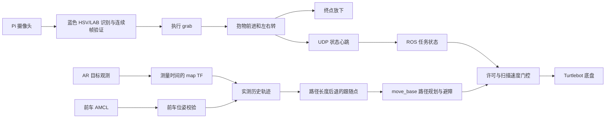

# 多机协同比赛方案设计

## 目标与分工

2026-10-09 分工更正：四个小组中，本组负责方式三 RGB-D 实时跟随与避障。以下 TonyPi 和方式二内容为仓库已有方案，不能据此认定本组仍负责这两部分。方式三当前实现与分步验收见 [follow3](../turtlebot/follow3/README.md)；满分所需的识别连续性、主动避障和全队终点验收尚未完成。

方式三现已编写颜色/深度候选识别、odom 中多帧关联、按路径长度后退的跟随目标、滚动点云 costmap 导航和独立速度门控。仅使用实时传感器与本车里程计，不以预建地图或前车广播位置作为识别来源。完整 ROS 导航和身份特征可靠性仍未实机验证，不能沿用下文“由队友补齐”的历史分工作为当前状态。

本方案实现 TonyPi 颜色识别与抱物路线控制，以及 Turtlebot2 的地图导航跟随。课程第一讲提供 AR 位姿消息接口，第三讲提供 gmapping/AMCL/move_base 导航基础，第四讲提供 LAB 颜色分割和 d6a 自定义抓取动作。

用户希望采用串行队列：TonyPi → 首车 → 后车。队列拓扑与跟随算法是两个维度：首车可识别背贴标记，方式二车辆可以直接观测 TonyPi，也可以通过前车共享地图位姿跟随。方式三队友需实现 RGB-D 身份筛选，方式四队友使用前车轨迹。

比赛要求三至四台 Turtlebot；原文不同章节分别写三四台和四台，评分表按四台、四种不同方式给满分。本方案按四台保留接入位置。原文“掉落”在任务说明与评分表的表述也有差别，现场计分以裁判确认为准，代码不虚构成绩。

## 数据流

## TonyPi

相机线程连续读取，控制线程只取最新帧。目标默认采用蓝色 HSV 阈值，也支持 LAB，使用形态学去噪和轮廓面积筛选，不强制圆形。横向偏差决定左右平移；目标下边缘和面积决定接近。达到阈值后须多帧位置稳定，才执行抓取。随后新画面的持物 ROI 或外部传感器确认成功；失败时复位并重新识别，默认最多三次。放下须另行确认手中无物块及放置 ROI 有物块。

固定头部姿态使画面位置可用于抓取距离标定。所有动作同步串行执行，不存在视觉线程与动作线程同时发舵机命令的竞争。只在动作结束之后使用新帧重新决策，不沿用踢球程序中的缓存球观测和开环快走。

抱物路线是经过现场标定的动作重复次数序列，左右转都必须存在。抱物时手臂默认锁定抓取结束姿态，放下阶段解除；直接读取 d6a 并逐帧调用总线 SDK，驱动异常向上抛出。没有自动避开新障碍的 TonyPi 路径规划器，因此必须测量场地路线和姿态摆幅。

## 建图避障跟随

赛前场地固定后 gmapping 建图，比赛用 AMCL 定位。AR 目标只使用指定 ID，在原观测时间执行 camera→map 变换；另一模式订阅前车 AMCL，要求共享 map frame、有限协方差和新鲜时间戳。

目标位置记录为有界的折线。跟随点沿折线按路径长度退后一定距离，避免简单沿目标朝向偏移在转角时产生横切目标点；标签朝向不作为 TonyPi 的行走方向。实际到该点的路径由 move_base 规划，所以仍可能在可通行区域平滑路径，并非精确轨迹回放。

目标点需要经过全局 costmap 的圆形足迹检查，未知区域和高占用区域不可进入。默认几何半径与膨胀是保守起始值，不代表已经测量过的机器人尺寸。动态扫描进入全局和局部 costmap，DWA 规划有限速度，不自动原地旋转恢复。

控制层检查目标、定位、TF、地图、任务心跳和最小距离；通过才发 move_base 目标与运动许可。独立速度门控还要求导航指令、许可和扫描均新鲜，并拒绝倒车和非有限指令。其壁钟线程在 ROS 仿真时钟停顿时仍能输出零速度。

AMCL 不动时不一定持续发位姿，因此定期调用 request_nomotion_update，并设置 resample_interval=1，使有新扫描时更新定位消息。扫描缺失不会凭服务调用制造定位心跳。

## 系统边界

- AR 背贴直接跟随参考控制器可以停车防前向碰撞，没有绕障规划；场地固定标签航路点程序未在本次实现。
- 方式三独立 RGB-D TonyPi 识别由队友补齐；不能宣称四种方式均已交付。
- 候选右转与放下动作、地图、运动距离、舵机零位尚需现场测量；镜像与反向帧只是动作编辑起点。
- 持物视觉 ROI 或外部反馈用于搬运动作结束后的掉落检查；遮挡和蓝色背景需做现场负样本验证。自动返回掉落点未实现。TonyPi 已确认无测距传感器，默认使用灰色地面外观与边缘的相机通道门控；不产生绝对距离，尚无自动绕障规划。可见通道不足或相机过期停车；同色低对比障碍仍可能漏检。默认终点放置许可由操作员/外部适配器提供。
- 软件检查不证明全程不会碰撞；扫描覆盖不到的矮障碍、双足摆动与无线故障需通过实机验收。

## 技术参考

官方实现用于核对接口：[Hiwonder 动作格式与 SDK](https://github.com/Hiwonder/TonyPi/blob/main/HiwonderSDK/hiwonder/ActionGroupControl.py)、[Hiwonder 颜色搬运示例](https://github.com/Hiwonder/TonyPi/blob/main/Functions/Transport.py)、[ROS Kinetic AMCL](https://github.com/ros-planning/navigation/blob/kinetic-devel/amcl/src/amcl_node.cpp)、[AR 标记检测节点](https://github.com/ros-perception/ar_track_alvar/blob/kinetic-devel/ar_track_alvar/nodes/IndividualMarkersNoKinect.cpp)。

提交正式报告时将 [验收记录](validation.md) 的实测参数、地图、现场照片、各方式实现和运行结果补入；本文件只记录实现方案，不含捏造的实验数据。
