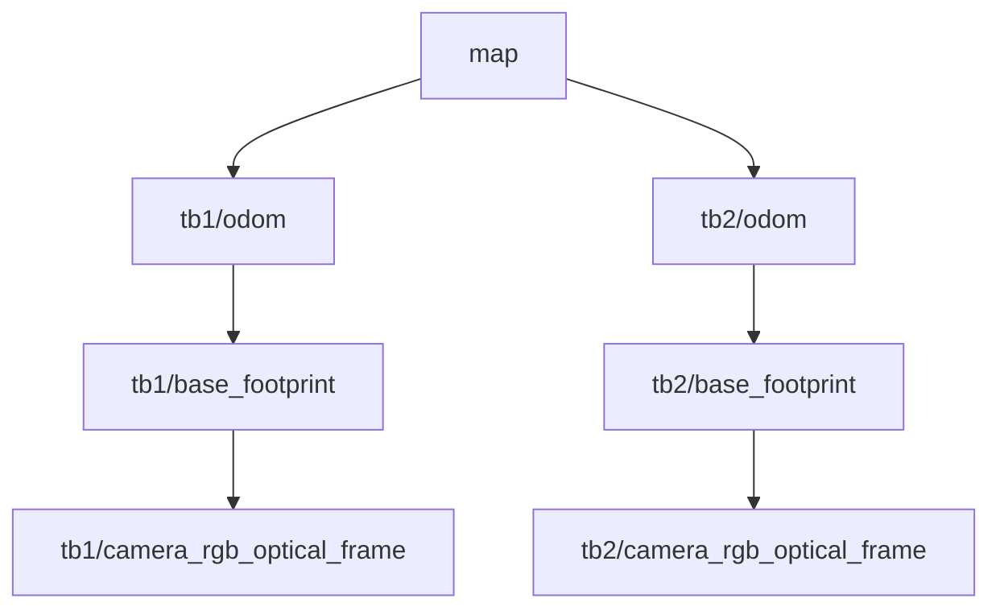

# 多机接口约定

方式三优化后的 follower/gate 必须接入本车新鲜 `nav_msgs/Odometry`（header 为本车 odom、child_frame_id 为本车 base），gate 还需注册 RGB 的 CameraInfo 与相机安装 TF。`follow.launch` 的 odom_topic 和 info_topic 会统一重映射。身份模板、视野、制动与录包参数见方式三教程；回放只能在独立 ROS master 的影子模式运行。

方式三当前有独立实现，见 [follow3](../turtlebot/follow3/README.md)。它使用本车 `odom` 中的实时 RGB-D 目标和滚动 costmap，不需要 AMCL 或共享 `map` 原点；下文共同地图要求适用于方式二和共享前车地图位姿的方式四。方式三复用 `/competition/mission` 和 `/competition/estop`，其专用门控为 `rgbd_velocity_gate.py`，不要同时启动两个门控竞争底盘输入。具体单车/多机命名参数以方式三 `follow.launch` 为准。

## 网络与版本

全队使用一个 ROS master。假设 ROS 主机为 192.168.1.100、Pi 为 192.168.1.101，实际 IP 以现场为准。每台运行 ROS 节点的电脑设置：

```bash
export ROS_MASTER_URI=http://192.168.1.100:11311
export ROS_IP=192.168.1.102  # 本机实际地址，不要所有电脑写同一个
source /opt/ros/kinetic/setup.bash
source ~/catkin_ws/devel/setup.bash
```

相互能够访问 ROS 节点端口，仅能 ping 到 master 不代表话题连接正常。所有设备校时；地图和图像使用采集时间戳，不能把陈旧测量改成当前时间。Pi 不运行 ROS，通过 UDP 15000 向桥发送状态。`session` 是队伍标识，桥还限制发送者 IP；它不提供远程舵机控制。

启动协议如下，字段由程序自动产生：

```json
{"session":"team1","run_id":"本次启动的UUID","sequence":12,"state":"carrying"}
```

间隔 0.2 秒，序号递增，桥忽略乱序消息；1 秒没有有效消息即发布 stopped。新 run_id 在旧会话超时后才接入。各后车还独立检查桥消息新鲜度，不依赖桥进程一定存活。

抓取/放置检查新增 `verifying_grasp`、`grasp_success`、`grasp_failed`、`retrying`、`checking_hold`、`checking_placement`、`verifying_release`。桥会转发这些状态，follower 在这些状态下关闭运动许可；`done` 仅在放置确认后发布。Pi 测距及外部反馈文件协议见[反馈指南](grasp_safety_placement.md)。

## 命名空间与 TF

| 设备 | 节点与话题命名空间 | 里程计坐标系 | 机体坐标系 |
|---|---|---|---|
| 第 1 台 Turtlebot | `/tb1` | `tb1/odom` | `tb1/base_footprint` |
| 第 2 台 Turtlebot | `/tb2` | `tb2/odom` | `tb2/base_footprint` |
| 第 3 台 Turtlebot | `/tb3` | `tb3/odom` | `tb3/base_footprint` |
| 第 4 台 Turtlebot | `/tb4` | `tb4/odom` | `tb4/base_footprint` |

共同地图坐标系为 `map`；每车 AMCL 发布 map→tbN/odom，底盘发布 tbN/odom→tbN/base_footprint，robot_state_publisher 发布机体→传感器。`/tf`、`/tf_static` 共享，**frame ID 本身要唯一**。命名空间与 frame ID 是两回事。



不要用任意静态 TF 假装 AMCL 定位，也不要把 TonyPi 动作次数转换成虚构地图位姿。参考课程代码中的 `/odom`、`/mobile_base/commands/velocity` 等为全局硬编码，不能在多机中直接启动。

## tb2 的话题和控制权

| 话题 | 类型 | 来源或作用 |
|---|---|---|
| `/tb2/ar_pose_marker` | `ar_track_alvar_msgs/AlvarMarkers` | 相机识别的固定 ID AR 观测 |
| `/tb2/target_pose` | `geometry_msgs/PoseStamped` | marker_target 或 pose_relay；二选一，map 坐标 |
| `/tb2/amcl_pose` | `geometry_msgs/PoseWithCovarianceStamped` | 本车 AMCL，检查协方差和时间 |
| `/tb2/move_base` | `move_base_msgs/MoveBaseAction` | 规划与避障 action server |
| `/tb2/move_base/global_costmap/costmap` | `nav_msgs/OccupancyGrid` | 拒绝未知/障碍目标点，完整更新 |
| `/tb2/cmd_vel_raw` | `geometry_msgs/Twist` | move_base 或直接 follower；二选一 |
| `/tb2/motion_allowed` | `std_msgs/Bool` | follower 心跳式运动许可 |
| `/tb2/cmd_vel_mux/input/navi` | `geometry_msgs/Twist` | velocity_gate 的输出，底盘导航输入 |
| `/tb2/scan` | `sensor_msgs/LaserScan` | 雷达或深度转换扫描 |
| `/tb2/follow_status` | `std_msgs/String` | 状态及停车原因 |
| `/competition/mission` | `std_msgs/String` | 全队任务状态 |
| `/competition/estop` | `std_msgs/Bool` | 全队 Turtlebot 门控停车 |

`velocity_gate` 是导航输入的唯一发布者。使用默认 Turtlebot2 速度 mux 时输入为 `/tbN/cmd_vel_mux/input/navi`，实际驱动不同则通过 `cmd_vel_topic` 指定。禁止其他节点直接发布 `/tbN/mobile_base/commands/velocity` 绕过 mux/门控。

静态激光扫描扇区缺少有限有效数据时，门控保守停车；部分 Kinect 深度扫描在空旷区域可能全 Inf，需要实测覆盖范围，不能为“让它动起来”直接关闭传感器检查。绕障能力来自 move_base 的局部和全局 costmap，门控只负责阻止危险速度，不负责找绕障路线。

## 各小组接入顺序

1. 每车单独调通底盘、扫描、相机和完整 TF。
2. 每车在相同地图中定位；实际把车放到同一个标定点，核对 map 坐标一致。
3. 地图目标模式先用 tb2 直接看到 TonyPi；确认实时目标点位置正确、丢失后停车。
4. 前车阻挡视野时选择前车 AMCL 模式，先确保前车定位和扫描刷新有效。
5. 根据车辆长度、步态速度、视野、弯道宽度调整队列间隔。参考值 0.9 m，不能机械套用。
6. 最后一车停车后比赛才结束。记录每车 follow_status 和实际终点位置。

若目标测量跳变超过 0.8 m，测量会被拒绝，不会自动向新位置追赶。定位或目标发生大的坐标重置后，先停全队、按规则重新定位，重启 follower 清除旧轨迹。导航失败也采用显式重启，不自动清图旋转恢复。
